  

  <b>I make local AI run fast on the AMD hardware on my desk, and build the tools I want along the way.</b> 
  Two Radeon GPUs, a Ryzen AI NPU and an Ubertooth: inference engines, model quants, dashboards and radio tools.

  
  
  
  
  

## About me

- **I tune local AI for the hardware it runs on.** Mostly large mixture-of-experts language models on two Radeon cards, and vision models on the NPU inside a Ryzen AI chip.
- **I build with AI coding agents.** I decide what to build, write the specs and tests, and run everything on my own machines; agents (Claude Code, and Qwen Code running on my own engine) write most of the code.
- **I publish the evidence.** Benchmarks in these repos come with their method and logs, including the cases where AMD's own stack or upstream llama.cpp still wins.
- **Security background:** CyberPatriot, and the National Cyber League (2021, my team placed in the top 100 in Georgia).
- **Looking for IT support / help desk work**, remote or around Maryland.

## Projects

### Local LLMs on two Radeon GPUs

| Project | What it is | Headline |
|---|---|---|
| [**Caminus**](https://github.com/jdominick05/caminus) | An inference engine written for two RDNA3 GPUs from the kernel up. It serves the Qwen3.8-Flash-Next Coder to Qwen Code, Claude Code and other harnesses over OpenAI- and Anthropic-compatible APIs. | About **104 tok/s**, **123–203 tok/s** with DFlash drafting: about twice llama.cpp on the same two cards.   |
| [**ignite‑llama**](https://github.com/jdominick05/ignite-llama) | My llama.cpp fork, tuned for Qwen3.8 Flash-Next decode on RDNA3 (ROCm/HIP). | **58.7 tok/s** against 36.3 with stock llama.cpp kernels (RX 7900 XTX + 7900 XT). |
| [**Flash-Next REAP-288 GGUF**](https://huggingface.co/jdominick05/Qwen3.8-Flash-Next-REAP-288-44GB-262k-GGUF) | A 288-expert prune of Qwen3.8 Flash-Next, quantized to run its full 262k context on 24 + 20 GB of VRAM. |  |
| [**Qwen3.8-27B GGUF**](https://huggingface.co/jdominick05/Qwen3.8-27B-24GB-262k-GGUF) | Mixed-precision quants that fit the full 262,144-token context on a single 24 GB GPU. |  |
| [**llm‑top**](https://github.com/jdominick05/llm-top) | `top` for your local LLM: a live terminal dashboard for llama-server or LM Studio, and the Qwen Code agents using it. Written in Go. |  |

### AI on the Ryzen AI NPU

| Project | What it is | Headline |
|---|---|---|
| [**Ignition**](https://github.com/jdominick05/Ignition) | Real-time YOLO on the AMD Ryzen AI (XDNA1) NPU, with a one-line install. | Faster end to end than AMD's own runtime on YOLOv8n, YOLO11n, YOLO26n and YOLOv8n-pose, and more accurate, from a fraction of the install size. |
| [**ignite‑xdna**](https://github.com/jdominick05/ignite-xdna) | The research behind Ignition: a bare-metal engine for the XDNA1 NPU, and every measurement behind it. | YOLOv8n in **7.15 ms** against 10.84 on AMD's stack (10.2 once its compiler is tuned), COCO mAP 34.1 against 26.7. Where AMD still wins is on the page too. |
| [**ignite‑scribe**](https://github.com/jdominick05/ignite-scribe) | An MCP server that turns your Windows desktop into redacted text an AI agent can read. | Password fields are never read; secrets are removed before anything leaves your PC. |

### Radio

| Project | What it is | Headline |
|---|---|---|
| [**fang**](https://github.com/jdominick05/fang) | A receive-only Ubertooth One toolkit: 2.4 GHz spectrum analyzer, BLE scanner, tracker detector and Classic Bluetooth survey. | Software CRC checks remove the stock tools' ghost devices; the spectrum view is about 12 dB more sensitive. |

## On my desk

- **GPUs:** AMD Radeon RX 7900 XTX (24 GB) + RX 7900 XT (20 GB), ROCm on Linux
- **NPU:** AMD Ryzen 7 8700G (XDNA1), Windows 11
- **Radio:** Ubertooth One
- **Agents:** Claude Code, Qwen Code

Every number on this page comes from the linked repo or model card.

